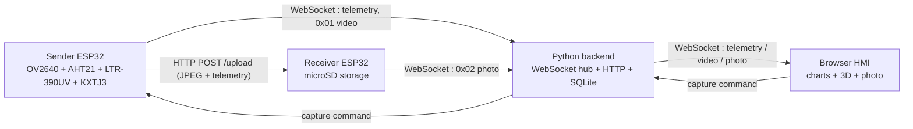

# Ground Pico-Satellite Multimodal Data Monitoring System

Ground prototype of a pico-satellite telemetry and imaging link. Two ESP32 boards
stream environmental telemetry and camera frames over WiFi to a Python backend,
which serves a browser HMI with live charts, a 3D acceleration vector and the
latest photo.

## Architecture



## Hardware

| Part | Role |
|---|---|
| ESP32-WROOM-32 (sender) | Camera + sensors, 20 fps video, telemetry, photo capture |
| ESP32-WROOM-32 (receiver) | Upload endpoint and SD card storage |
| OV2640 | Camera, QVGA JPEG, DVP interface, frame buffers in PSRAM |
| AHT21 (driver `IWA`) | Temperature and humidity |
| LTR-390UV (driver `ILB`) | Illuminance and UV index |
| KXTJ3-1057 (driver `IIA`) | 3-axis accelerometer |
| microSD module | Photo (`.jpg`) and telemetry (`.json`) storage |

I2C is on GPIO26 (SDA) / GPIO27 (SCL); the receiver uses SPI with CS 5, MOSI 13,
MISO 12, SCK 14.

## Interfaces

- **Client identity** — the first WebSocket message from every client is
  `{"type": "sender" | "receiver" | "frontend"}`; a client that does not identify
  within 5 s is disconnected.
- **Telemetry** — every 3 s the sender pushes JSON over WebSocket:
  `temperature`, `humidity`, `uvi`, `lux`, `ax`, `ay`, `az`, `timestamp`.
- **Video** — binary WebSocket frames with a 1-byte type prefix `0x01`, 20 fps.
- **Photo** — a capture is triggered from the HMI; the sender uploads the JPEG to
  the receiver with `POST /upload` and the `X-File-Name` / `X-Sensor-Data`
  headers, the receiver stores it on the SD card and forwards it as `0x02`.
- **Ports**

  | Port | Service |
  |---|---|
  | 5001 | Backend WebSocket hub (subprotocol `arduino`) |
  | 5000 | Backend HTTP: HMI page, `/api/sensor/latest`, `/api/capture` |
  | 8080 | Receiver upload endpoint (`POST /upload`) |
  | 80 | Receiver file server (`/latest_photo`, `/photos`, `/sensor_data`) |
  | 80 | Sender HTTP server (`POST /capture`, `GET /sensor`, `GET /stream` MJPEG) |

- **Backpressure** — each frontend has its own send queue (capacity 20); once it
  is full, incoming frames are dropped rather than queued, and the sender drops
  video frames when its own send queue already holds 5.

## Repository layout

```
code/
  lib/       shared drivers (IWA / ILB / IIA), camera pin map, sensor registers
  sender/    ESP32-CAM firmware: camera, sensors, WiFi, HTTP server, WebSocket, uploader
  receiver/  ESP32 firmware: SD card, TCP upload server, file server, WebSocket client
  server/    Python backend: config, database, connection manager, handlers, entry point
  web/       Browser HMI: index.html, stylesheet, ES modules (charts, 3D, sensors, WebSocket)
datasheet/   component datasheets
```

## Setup

Backend (Python 3.9+):

```bash
pip install websockets aiohttp aiohttp-cors
python code/server/app.py
```

Then open `http://<backend-host>:5000`.

Firmware (Arduino IDE with the ESP32 core, `ArduinoJson` and the `WebSockets`
library by Markus Sattler):

1. In `code/sender/` and `code/receiver/`, copy `config.example.h` to `config.h`
   (the real `config.h` is git-ignored) and fill in your WiFi credentials and the
   board IPs; set the device IPs in `code/server/config.py` and
   `code/web/js/config.js` to the same addresses.
2. Flash `code/sender/sender.ino` and `code/receiver/receiver.ino`.

Both sketches include the shared drivers as `../lib/...`, so `code/lib` must be
part of the build — keep the `code/<board>/` next to `code/lib/` layout, or copy
the drivers into the sketch folder.

## HMI features

- Live tiles for temperature, humidity, UV index, illuminance, 3-axis and
  resultant acceleration.
- Three Chart.js trends with fixed axis ranges and a 30-point sliding window.
- Three.js 3D acceleration vector (arrow direction and magnitude, orbit controls).
- Latest photo and live video panels fed by the `0x02` / `0x01` binary frames.
- Sender / Receiver / WebSocket status indicators and automatic reconnection with
  exponential backoff.

## Notes

- The backend keeps the most recent 60 telemetry samples in memory and the full
  history in SQLite (`sensor_data.db`).
- Sensor read failures are reported as `-999` and filtered out by the HMI.
- IP addresses are placeholders in every published config file; set them to your
  own addresses (same LAN and subnet, static, outside the DHCP pool).

## Credits

The sensor and camera drivers in `code/lib` are adapted from third-party
projects:

| Files | Origin | License |
|---|---|---|
| `IWA.h`, `IWA.cpp` | [domino4com/IWA](https://github.com/domino4com/IWA) | CC BY-NC-SA 4.0 |
| `ILB.h`, `ILB.cpp` | [domino4com/ILB](https://github.com/domino4com/ILB) | CC BY-NC-SA 4.0 |
| `IIA.h`, `IIA.cpp` | [domino4com/IIA](https://github.com/domino4com/IIA) by Bjarke Gotfredsen | file header states MIT; the upstream repository states CC BY-NC-SA 4.0 |
| `lis2dh12_reg.h` | STMicroelectronics | BSD-3-Clause |
| `camera_index.h`, `camera_pins.h`, `board_config.h` | Espressif ESP32 camera example | Apache-2.0 |

The CC BY-NC-SA 4.0 files carry attribution, non-commercial and share-alike
terms: keep the credit, do not use them commercially, and keep adaptations
under the same license.

## License

MIT for the rest of the project — see [LICENSE](LICENSE).
